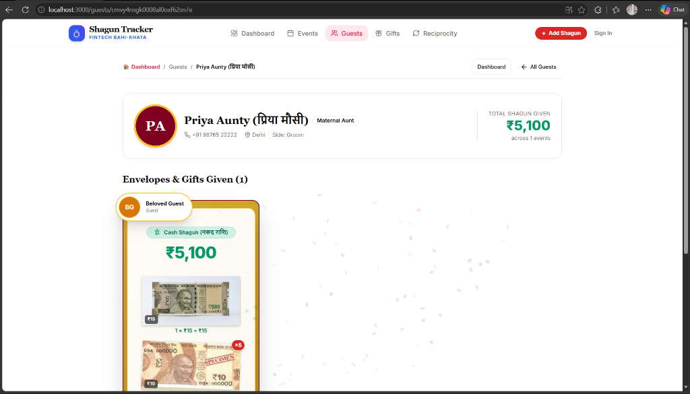
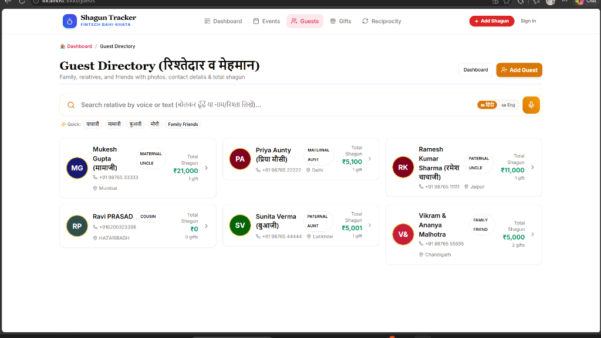
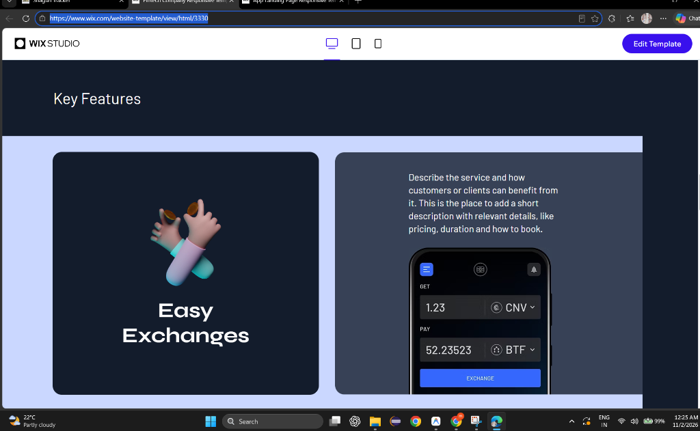
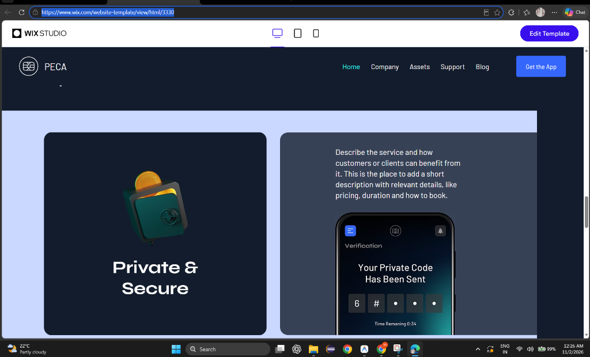
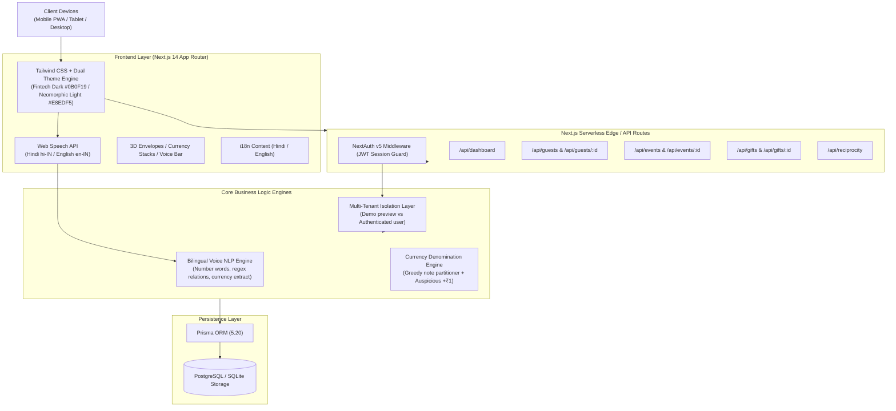
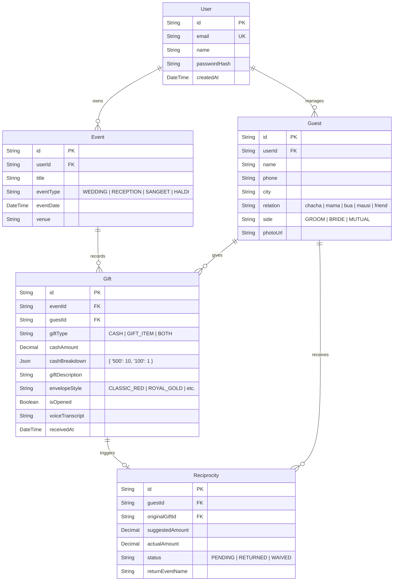
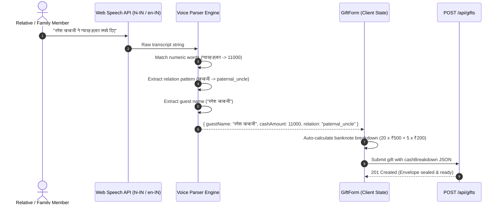

# 💍 Shagun Tracker (शगुन बही-खाता)
### Next-Gen Indian Wedding Fintech, Digital Registry & Reciprocity Ledger

[](https://nextjs.org/)
[](https://www.typescriptlang.org/)
[](https://www.prisma.io/)
[](https://tailwindcss.com/)
[](https://vitest.dev/)
[](https://opensource.org/licenses/MIT)

> **Shagun Tracker** transforms traditional Indian wedding cash gift (*शगुन*) tracking into an ultra-premium, interactive digital ledger. Designed to withstand the fast-paced, high-pressure chaos of wedding celebrations, receptions, and sangeet ceremonies, it eliminates lost envelopes, inaccurate paper diaries (*बही-खाता*), mental math mistakes, and awkward reciprocity confusion.

---

## 📸 Visual Showcase & Feature Highlights

| Wix Studio Fintech Dark Mode | 3D Sealed Burgundy Velvet Envelope |
| :---: | :---: |
|  |  |
| *Midnight navy `#0B0F19` with floating gold coins & mobile mockup* | *Bespoke velvet cardstock with ॐ wax seal & botanical sprig* |

| Relative Guest Directory & Voice Search | RBI Cash Notes Breakdown |
| :---: | :---: |
|  |  |
| *Bilingual search by voice or text with instant delete actions* | *Authentic RBI note stacks (₹500, ₹200, ₹100, +₹1 coin)* |

| Key Features Bento Container | Live 4-Digit Security PIN Demo |
| :---: | :---: |
|  |  |
| *Wix Studio soft ice-blue curved bento showcase* | *Interactive tactile keypad demo with instant confetti unlocking* |

---

## 🏛️ High-Level Design (HLD)

### 1. System Architecture Overview



### 2. Multi-Tenant User Isolation Architecture

To ensure families have complete privacy for their financial wedding gifts:
* **Unauthenticated / Demo Sessions**: Reads from `demo@shagun.app` mock data (Sharma family), clearly displaying an amber preview badge.
* **Authenticated User Sessions**: Every database query filters by `userId: authUser.id`. New users start with a clean slate (`0 events, 0 guests, 0 gifts`) and a 3-step setup journey. Under no circumstance is demo data shown to a registered user.

---

## 🔬 Low-Level Design (LLD)

### 1. Database Schema & Entity Relationship Diagram (ERD)



### 2. Speech-to-Text & NLP State Machine



---

## 🚀 In-Depth Feature Catalog

### 1. 💌 3D Tactile Burgundy Velvet Envelopes
* **Pinterest Silhouette**: Handcrafted deep burgundy velvet cardstock with a sharp geometric V-flap.
* **Botanical Sprig**: Dried wheat / baby's breath botanical sprig tucked behind an antique metallic gold wax seal featuring an engraved ॐ emblem.
* **3D Unsealing**: Tapping the seal animates the flap upward, fires festive confetti, and smoothly elevates the parchment letter to display the cash amount, currency note stacks, reseal button, and ledger confirmation.

### 2. 🎙️ Dual Voice Entry (Hindi & English)
* **Real-time Recognition**: Speech recognition in Hindi (`hi-IN`) and Indian English (`en-IN`).
* **Sanskrit/Hindi Number Parsing**: Converts spoken phrases like *पचास हज़ार* (50,000), *इक्कीस सौ* (2,100), *पाँच हज़ार एक* (5,001) into numeric values with zero math errors.
* **Fuzzy Matching**: Matches spoken names with guests already in the directory, or auto-populates the inline quick-add relative modal.

### 3. 💵 RBI Currency Breakdown & Auspicious +₹1 Coin
* **Authentic Banknotes**: Visual note stacks for ₹2,000, ₹500, ₹200, ₹100, ₹50, ₹20, and ₹10.
* **Auspicious Coins**: Special ₹1, ₹2, ₹5, and ₹10 metallic coins representing sacred *shagun* additions.
* **Greedy Denomination Algorithm**: Computes the optimal note distribution based on actual RBI currency circulation patterns.

### 4. 🔄 Reciprocity Ledger (लेन-देन हिसाब)
* **Never Forget a Blessing**: When guests gift shagun to your family, a reciprocal obligation is automatically generated.
* **Smart Increment Rule**: Suggests auspicious return amounts (+₹1, +₹500, +₹1,000) when attending their future family celebrations.
* **Audit Trail**: Mark obligations as *Returned*, record the return ceremony name, and track payment history.

### 5. 👥 Guest Directory with Audio Search & Direct Deletion
* **Instant Voice Search**: Search relatives by speaking or typing their relation (*मामाजी*, *चाचा*, *बुआ*) or city (*Jaipur*, *Mumbai*).
* **Direct Deletion**: Delete guests and their cascade records directly from cards with confirmation safeguards.
* **Inline Creation**: Add missing relatives and events on-the-fly without leaving the shagun registration form.

### 6. 🎨 Dual Design System
* **Midnight Fintech Dark (`#0B0F19`)**: Wix Studio Fintech template styling with dark obsidian surfaces, radial cyan glows, and floating 3D coins.
* **Neomorphic Soft UI Light (`#E8EDF5`)**: Dribbble-inspired soft clay cards with dual drop shadows (`9px 9px 20px #CAD4E2, -9px -9px 20px #FFFFFF`) and debossed inset search inputs.

---

## 📡 API Endpoints Reference

| Method | Endpoint | Description | Auth Required |
| :--- | :--- | :--- | :---: |
| `GET` | `/api/dashboard` | Dashboard metrics, recent gifts, and reciprocity status | Session |
| `GET` | `/api/guests` | Search and filter guest directory by relation, side, query | Session |
| `POST` | `/api/guests` | Create new relative profile | Session |
| `GET` | `/api/guests/:id` | Get relative profile, gift history, and total given | Session |
| `DELETE`| `/api/guests/:id` | Cascade delete relative and associated records | Session |
| `GET` | `/api/events` | List all wedding ceremonies (Wedding, Reception, Haldi) | Session |
| `POST` | `/api/events` | Create new wedding ceremony | Session |
| `GET` | `/api/gifts` | Filter shagun registry by event, guest, or gift type | Session |
| `POST` | `/api/gifts` | Record shagun envelope and generate reciprocity entry | Session |
| `DELETE`| `/api/gifts/:id` | Delete shagun gift record | Session |
| `GET` | `/api/reciprocity`| List pending and completed return obligations | Session |
| `PUT` | `/api/reciprocity`| Update reciprocity status (*RETURNED*, *PENDING*) | Session |
| `POST` | `/api/auth/register`| Register new family user account | Public |

---

## 🛠️ Installation & Getting Started

### Prerequisites
* **Node.js**: v18.17.0+ or v20.x
* **npm**: v9.x+

### Quick Setup

```bash
# 1. Clone repository
git clone https://github.com/raviattrash-pro/shagun-tracker.git
cd shagun-tracker

# 2. Install dependencies
npm install

# 3. Configure environment variables
cp .env.example .env.local

# 4. Initialize Database & Seed Demo Data
npm run db:push
npm run db:seed

# 5. Start development server
npm run dev
```

Visit `http://localhost:3000` to view the application.

---

## 🧪 Testing & Verification

The test suite runs on [Vitest](https://vitest.dev/) with automated unit tests for voice NLP parsing, currency calculations, and data validation:

```bash
# Run unit test suite
npm run test

# Run tests in watch mode
npm run test:watch
```

```
✓ tests/unit/voice-parser.test.ts (4 tests)
✓ tests/unit/currency.test.ts     (4 tests)
✓ tests/unit/validators.test.ts   (4 tests)

Test Files  3 passed (3)
Tests       12 passed (12)
```

---

## 📄 License
This project is licensed under the [MIT License](LICENSE).
