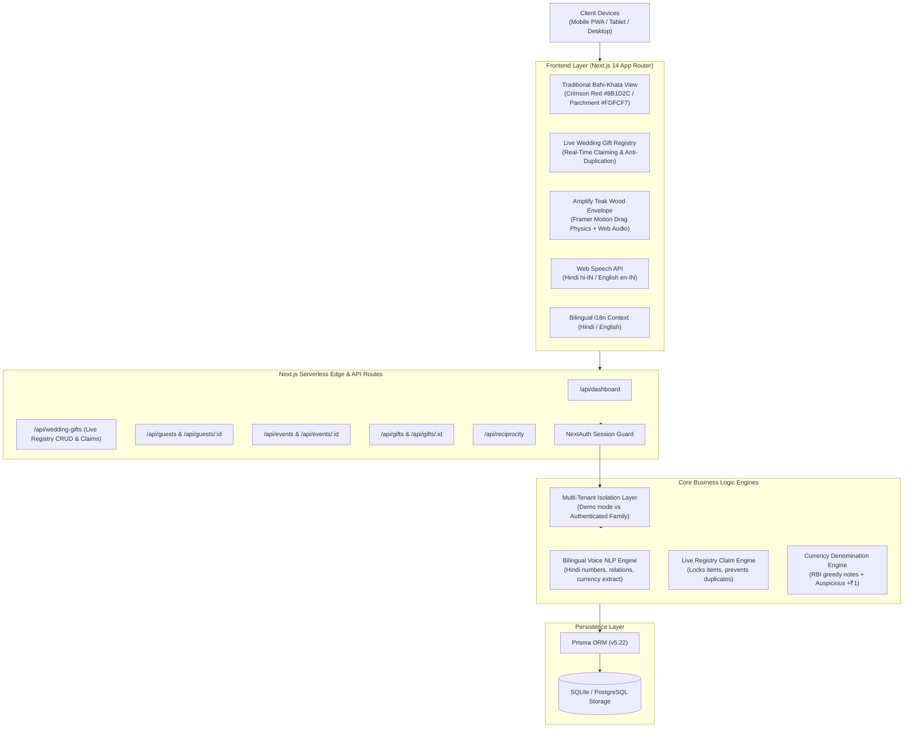
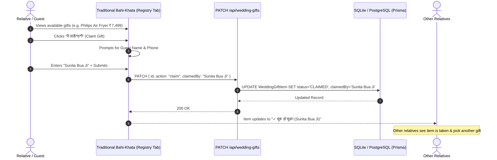
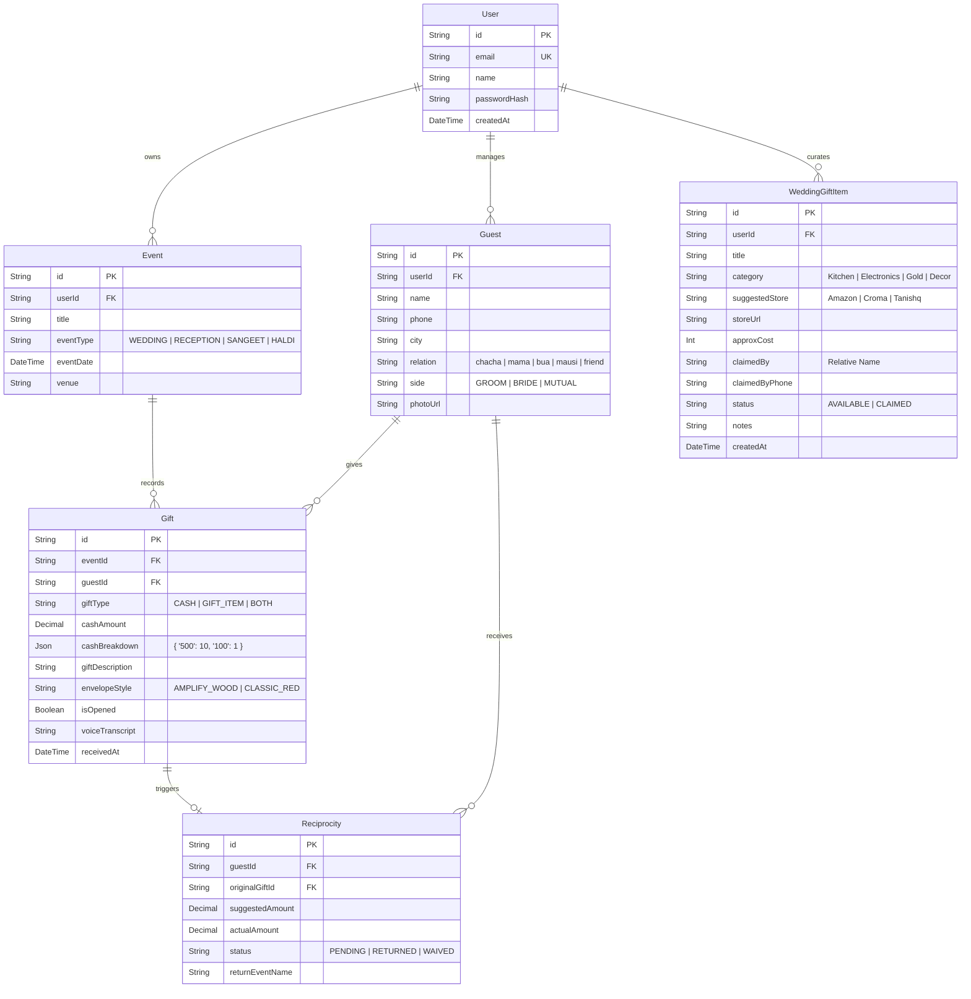

# 💍 Shagun Tracker (शुभ विवाह बही-खाता)
### Traditional Indian Wedding Bahi-Khata, Live Gift Registry & Shagun Cash Manager

[](https://nextjs.org/)
[](https://www.typescriptlang.org/)
[](https://www.prisma.io/)
[](https://tailwindcss.com/)
[](https://vitest.dev/)
[](https://opensource.org/licenses/MIT)

> **Shagun Tracker** transforms traditional Indian wedding cash gift (*शगुन*) tracking into an authentic, respectful digital **Bahi-Khata (पारंपरिक बही-खाता / लाल डायरी)** alongside a **Live Digital Wedding Gift Registry (लाइव शादी उपहार सूची)**. 
> 
> Designed to eliminate lost paper envelopes, mental math mistakes, awkward reciprocity confusion, and **duplicate wedding gifts**, Shagun Tracker gives families the simplicity and warmth of the red cloth ledger with real-time digital superpowers.

---

## 🌟 Core Pillars

1. **📖 Traditional Bahi-Khata (पारंपरिक लाल डायरी)**
   * Authentic ruled ledger styling (`|| श्री गणेशाय नमः ||`, `|| शुभ लाभ ||`, red spine cloth).
   * Tabbed sections for **Cash Shagun (नकद बही-खाता)**, **Live Wedding Registry (लाइव उपहार सूची)**, **Received Gifts (प्राप्त सामान)**, and **Reciprocity (लेन-देन डायरी)**.
   * Built-in 1-click ledger print and export.

2. **🎁 Live Wedding Gift List & Registry (लाइव शादी उपहार सूची)**
   * Curated gift wishlist (`Gift/Item`, `Suggested Store`, `Approx Cost`, `Who is bringing it?`, `Status`, `Notes`).
   * **Anti-Duplication**: Real-time `AVAILABLE (उपलब्ध)` vs `CLAIMED (बुक हो चुका)` tracking.
   * **1-Click Claim**: Guests can claim an item (*"मैं लाऊँगा/गी"*) so other relatives immediately know what is already taken and what is left.

3. **💌 Amplify Teak Wood Animated Envelope (काष्ठ लिफ़ाफ़ा)**
   * Hyper-realistic teak/walnut grain with debossed *AMPLIFY / SHAGUN* typography and lush canopy.
   * Luminous curved crest with white glove grab handle.
   * Radiant volumetric light leak and glowing amber energy seal (⚡).
   * Natural spring drag-down unsealing physics powered by Framer Motion.
   * Web Audio API synthesized cedar slide and crystal seal chime.

4. **🎙️ Bilingual Hindi & English Voice AI**
   * Spoken number parsing (*"ग्यारह हज़ार रुपये"*, *"इक्कीस सौ"*, *"पाँच हज़ार एक"*).
   * Automatic relation and name extraction (*"रमेश चाचाजी"*, *"सुनीता बुआ"*).

5. **💵 RBI Banknotes Breakdown & Auspicious +₹1 Coin**
   * Visual note stacks (₹500, ₹200, ₹100, ₹50, ₹20, ₹10).
   * Auspicious metallic coins (+₹1, +₹2, +₹5, +₹10).
   * Smart reciprocity calculation (+₹1 auspicious addition).

---

## 🏛️ High-Level Design (HLD)

### 1. System Architecture Overview



### 2. Live Wedding Gift Claim Sequence (Anti-Duplication)



---

## 🔬 Low-Level Design (LLD)

### 1. Database Schema & Entity Relationship Diagram (ERD)



---

## 📡 API Endpoints Reference

| Method | Endpoint | Description | Auth Required |
| :--- | :--- | :--- | :---: |
| `GET` | `/api/wedding-gifts` | Fetch all wedding wishlist items and registry summary stats | Public / Demo |
| `POST`| `/api/wedding-gifts` | Add a new desired gift to wedding registry wishlist | Session |
| `PATCH`| `/api/wedding-gifts` | Claim (`action: "claim"`) or unclaim (`action: "unclaim"`) a gift | Public / Guest |
| `DELETE`| `/api/wedding-gifts`| Remove an item from the registry wishlist | Session |
| `GET` | `/api/dashboard` | Dashboard metrics, recent gifts, and reciprocity status | Session |
| `GET` | `/api/guests` | Search and filter guest directory by relation, side, query | Session |
| `POST` | `/api/guests` | Create new relative profile | Session |
| `GET` | `/api/guests/:id` | Get relative profile, gift history, and total given | Session |
| `DELETE`| `/api/guests/:id` | Cascade delete relative and associated records | Session |
| `GET` | `/api/events` | List all wedding ceremonies (Wedding, Reception, Haldi) | Session |
| `POST` | `/api/events` | Create new wedding ceremony | Session |
| `GET` | `/api/gifts` | Filter shagun registry by event, guest, or gift type | Session |
| `POST` | `/api/gifts` | Record shagun envelope and generate reciprocity entry | Session |
| `DELETE`| `/api/gifts/:id` | Delete shagun gift record | Session |
| `GET` | `/api/reciprocity`| List pending and completed return obligations | Session |
| `PUT` | `/api/reciprocity`| Update reciprocity status (*RETURNED*, *PENDING*) | Session |
| `POST` | `/api/auth/register`| Register new family user account | Public |

---

## 🛠️ Installation & Getting Started

### Prerequisites
* **Node.js**: v18.17.0+ or v20.x
* **npm**: v9.x+

### Quick Setup

```bash
# 1. Clone repository
git clone https://github.com/raviattrash-pro/shagun-tracker.git
cd shagun-tracker

# 2. Install dependencies
npm install

# 3. Configure environment variables
cp .env.example .env.local

# 4. Initialize Database & Push Schema
npx prisma db push
npm run db:seed

# 5. Start development server
npm run dev
```

Visit `http://localhost:3000` to view the traditional bahi-khata and live wedding registry.

---

## 🧪 Testing & Verification

The test suite runs on [Vitest](https://vitest.dev/) with automated unit tests for voice NLP parsing, currency calculations, and data validation:

```bash
# Run unit test suite
npm run test

# Run TypeScript type check
npm run type-check
```

```
✓ tests/unit/voice-parser.test.ts (4 tests)
✓ tests/unit/currency.test.ts     (4 tests)
✓ tests/unit/validators.test.ts   (4 tests)

Test Files  3 passed (3)
Tests       12 passed (12)
```

---

## 📄 License
This project is licensed under the [MIT License](LICENSE).
